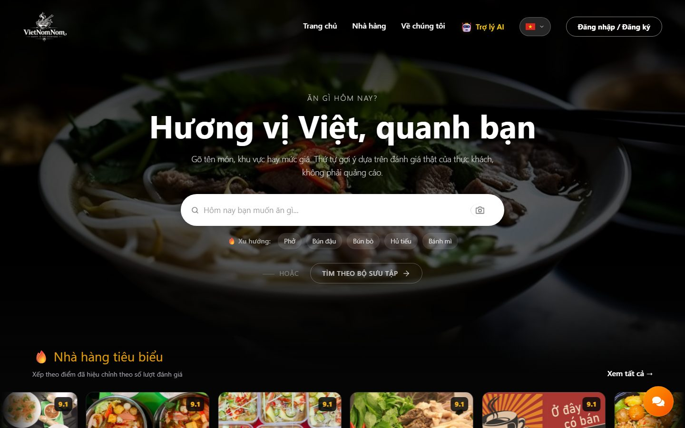
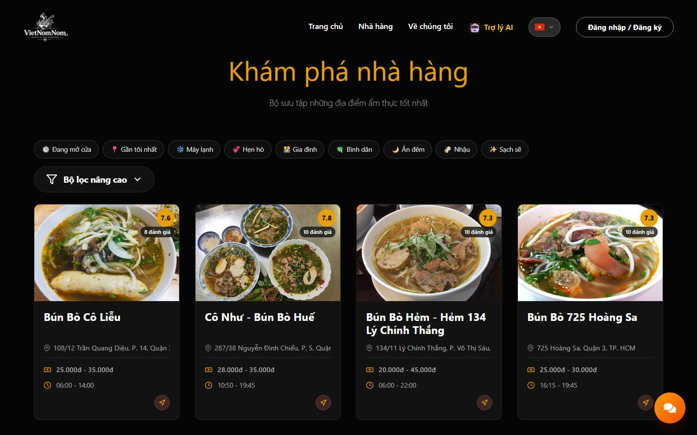
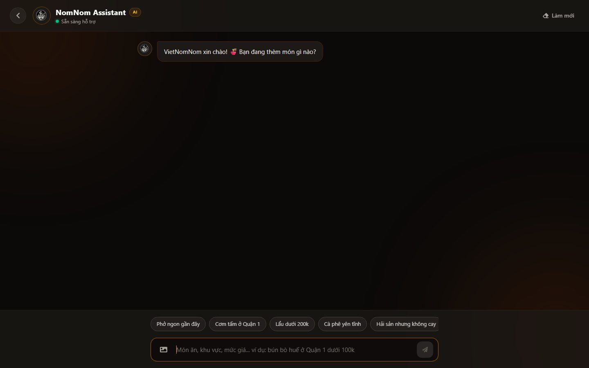
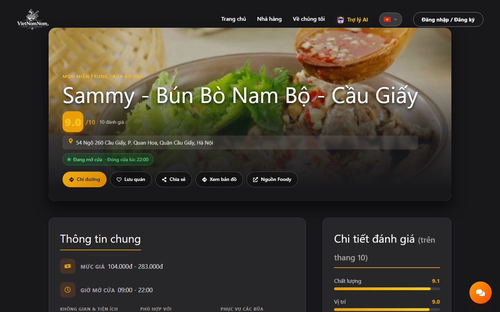

# VietNomNom — Hương vị Việt, quanh bạn

**VietNomNom** giúp bạn trả lời câu hỏi muôn thuở "hôm nay ăn gì, ăn ở đâu". Bạn chỉ cần gõ như đang nói chuyện,
ví dụ *"bún bò quận 3 dưới 50k"* hay *"nhóm 5 người, tối nay, lẩu 150k/người"*, và web sẽ gợi ý quán dựa trên
**đánh giá thật của thực khách**, không phải quảng cáo.

🌐 **Dùng thử:** <https://project-smart-food-recommendation-f.vercel.app>



Hơn **5.500 quán** ở Hà Nội, TP.HCM, Đà Nẵng và nhiều tỉnh khác, với **hơn 26.000 review** đã được AI đọc và tóm tắt.

## Tính năng nổi bật

### 🔎 Tìm quán bằng câu nói tự nhiên

Không cần chọn từng bộ lọc. Web tự hiểu món, khu vực, mức giá, buổi trong ngày và số người trong câu bạn gõ, kể cả
khi gõ không dấu ("bun bo q3"). Có vị trí của bạn thì quán gần được ưu tiên trước.



### 🤖 Trợ lý AI NomNom

Trợ lý trò chuyện nổi ở mọi trang, nhớ ngữ cảnh: hỏi tiếp "rẻ hơn đi" hay "còn quán nào khác" là trợ lý sửa lại kết
quả cũ. Trợ lý hiểu "tối nay" là phải còn mở cửa lúc tối, "nhóm 5 người" thì nhắc gọi đặt bàn trước. Khi chỉ còn ít
quán, trợ lý nói rõ đã lọc theo điều kiện nào. Khi chưa có dữ liệu, trợ lý nói thẳng là chưa có thay vì bịa.



### 💬 Review được AI tóm tắt theo từng khía cạnh

Mỗi quán có phần tóm tắt **món ăn, giá, phục vụ, không gian, vệ sinh, chỗ để xe**: khía cạnh nào được khen, bị chê
hay ý kiến còn chia đôi, kèm câu trích **nguyên văn** từ review. Bạn biết quán này "ngon nhưng chỗ để xe chật" chỉ
trong vài giây.

### ❓ Hỏi đáp riêng về từng quán

Ngay trong trang quán, hỏi *"giá ở đây thế nào?"* hay *"có chỗ đậu ô tô không?"* và nhận câu trả lời dựa trên review
thật. Có sẵn câu hỏi gợi ý để bấm, không cần nghĩ cách hỏi.



### ⭐ Điểm số công bằng

Điểm được **hiệu chỉnh theo số lượt đánh giá**, nên quán chỉ có vài review 10 điểm không vượt được quán đã giữ chất
lượng qua hàng trăm lượt. Mọi nơi trên web (thẻ quán, trang chi tiết, trợ lý AI) hiện cùng một con số, và điểm gốc
bên Foody vẫn được ghi rõ để đối chiếu.

### 📸 Tìm bằng ảnh món ăn

Chụp hoặc tải ảnh món ăn lên, AI nhận ra món (phở, bún, bánh mì, gỏi cuốn, bột chiên) rồi gợi ý quán bán món đó.
Ảnh chưa rõ thì AI gợi ý các món gần giống để bạn bấm chọn.

### 🕒 "Ăn gì bây giờ?"

Trang chủ gợi ý quán **đang mở cửa, hợp với bữa hiện tại** (sáng, trưa, chiều, tối, khuya) và gần bạn. Còn phân vân
thì bấm 🎲 **"Hôm nay ăn gì?"** để web bốc ngẫu nhiên một quán phù hợp. Mỗi quán hiện trạng thái thời gian thực: đang mở,
sắp đóng cửa, hay mấy giờ mở lại.

### Và còn nữa

- 🗺️ **Chỉ đường** ngay trên bản đồ, từ vị trí của bạn tới quán.
- 🍜 **Quán tương tự** cùng quận, hoặc cùng thành phố khi quận không đủ quán.
- ⚖️ **So sánh 2–3 quán** cạnh nhau: điểm từng tiêu chí, giá, khoảng cách.
- ❤️ **Lưu quán** yêu thích; khai báo khẩu vị trong tài khoản để trợ lý AI gợi ý hợp gu hơn.
- ✍️ **Viết review** (mỗi tài khoản một review cho mỗi quán), AI tự nhận biết review khen hay chê.
- 📚 **Bách khoa món Việt**: nguồn gốc và đặc trưng của từng món.
- 🇻🇳🇬🇧 **Song ngữ Việt / Anh**, đăng nhập bằng Google, giao diện tối, dùng tốt trên điện thoại.

## Cách hoạt động

```text
Website (Next.js, Vercel) → API (NestJS, Render) → AI service (FastAPI, Hugging Face) → MongoDB Atlas
```

Toàn bộ AI (hiểu câu hỏi, xếp hạng, đọc review, nhận diện ảnh) dùng **model mã nguồn mở** chạy trong AI service.
Chi tiết kỹ thuật nằm ở các repo:

- AI service: [Project-Smart-Food-Recommendation-AI](https://github.com/ddanh2436/Project-Smart-Food-Recommendation-AI) (kỹ thuật, model, credits và license)
- Backend: [Project-Smart-Food-Recommendation-Backend](https://github.com/ddanh2436/Project-Smart-Food-Recommendation-Backend)

Dữ liệu quán và review được thu thập từ Foody.vn cho mục đích học tập. Mỗi trang quán đều có link về nguồn gốc.

## Dành cho lập trình viên

**Công nghệ:** Next.js 16 (App Router), React 19, TypeScript strict, Tailwind v4 cho phần chat, Leaflet +
leaflet-routing-machine (OpenStreetMap / OSRM), axios.

```bash
cp .env.example .env.local     # NEXT_PUBLIC_API_URL = địa chỉ Backend, NEXT_PUBLIC_SITE_URL = địa chỉ web
npm install
npm run dev                    # http://localhost:3000
npm run build && npx tsc --noEmit && npm run lint
```

Một vài quy ước trong code:

- `app/lib/api.ts` là nơi duy nhất gọi Backend. Client tự refresh token khi gặp 401, và thay mọi điểm bằng điểm đã
  hiệu chỉnh (điểm gốc giữ ở `rawScores`).
- Chuỗi giao diện nằm hết trong `app/lib/i18n.ts`, đọc qua `useTranslation()`.
- Component render ở server không được dùng `Math.random()`, `Date.now()` hay `localStorage` trong lần render đầu,
  nếu không sẽ gặp lỗi hydration #418.
- Thêm host ảnh mới thì sửa cả `images.remotePatterns` lẫn `imageHosts` của Content-Security-Policy trong
  `next.config.ts`.

Triển khai: xem [DEPLOY.md](./DEPLOY.md).
